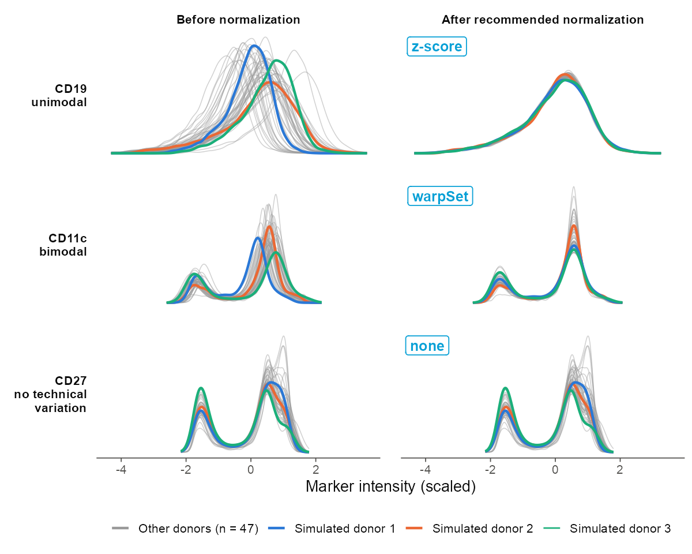
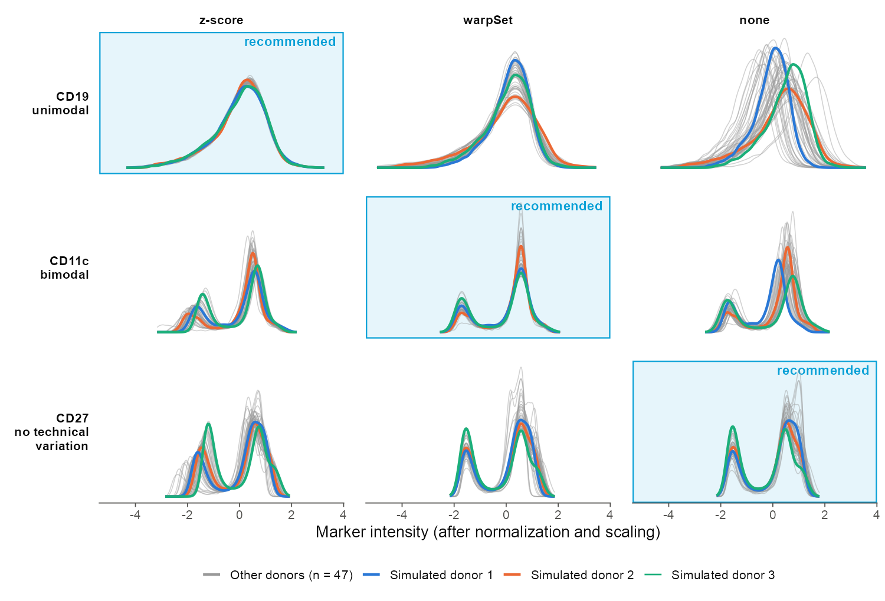

# briDiscovr

**briDiscovr** is an R package for identifying and quantifying cell populations in high-dimensional cytometry data (CyTOF, conventional flow, and spectral flow). It uses clustering and cross-sample normalization to identify populations of cells present across samples, and quantifies cells in those clusters in each sample.

The core workflow is:

1. **Set up** an experiment from .fcs files and two simple .csv manifests (markers and samples), with arcsinh transformation and optional downsampling.
2. **Cluster** the events within each sample separately (Phenograph).
3. **Normalize** marker expression across samples, choosing for each marker between z-score, warpSet peak alignment, or no normalization.
4. **Metacluster** the sample-specific clusters across all samples into shared cell populations.
5. **Quantify and characterize** the metaclusters, with per-sample occupancy tables, heatmaps of marker expression, and UMAP embeddings.

Clustering each sample on its own before metaclustering keeps sample-specific technical variation from driving the population definitions.

The package can also place a rare cell subset in the context of a larger parent population. Examples are antigen-specific T or B cells identified by tetramer staining, compared with all CD8+ T cells or all B cells. The rare cells are clustered together with their parent population, and the package reports how they are distributed across the parent population's metaclusters. This was the original purpose of the method (DISCOV-R: *Distribution analysis across clusters of a parent population overlaid with a rare subpopulation*). It is still fully supported, but most analyses now use the core workflow above.

> **Background and development status.** The DISCOV-R method was first developed for Wiedeman, Muir, et al. 2020, "Autoreactive CD8+ T cell exhaustion distinguishes subjects with slow type 1 diabetes progression", *J Clin Invest* ([PMID 31815738](https://pubmed.ncbi.nlm.nih.gov/31815738/)). The package is under continued development, and the current version differs from the code used in that paper. For example, version 0.4 added flexible per-marker normalization (see [Normalizing marker expression](#normalizing-marker-expression)), along with downsampling, UMAP, and memory and speed improvements. If you use briDiscovr, please cite the paper above and report the package version you used.

---

## Installation

1. Install R v4.0+ from https://cloud.r-project.org/
  * If you're using Windows, you'll need to install the version of Rtools that matches your R version from https://cran.r-project.org/bin/windows/Rtools/ as well
2. Open R and install devtools using ```install.packages("devtools")```
3. Install this package using ```devtools::install_github("BenaroyaResearch/briDiscovr")```
  * If you encounter difficulties with any dependency packages, please see the "Dependencies" section at the bottom of this page.

---

## Usage

This package is based around the `discovrExperiment` object class, which is a list that holds all of the information about your experiment. You can save, load, and copy `discovrExperiment` objects to facilitate different phases of the analysis.

### Preparing to start your analysis

Before running DISCOV-R, you'll need to prepare a marker information file and a .fcs information file. Both of these can be created in Excel, and should be saved in the 'comma-separated values (.csv)' format.

#### marker information file

This file should contain 3 columns (plus 1 optional column):

* A column for the common name of your marker (eg: "CD45RA") - by default this column is expected to be named 'fixed'
* A column for the marker name as it's represented in the .fcs data (eg: "143Nd_CD45RA") - by default this column is expected to be named 'desc'
* A column named 'useToCluster' that indicates whether the marker will be used for clustering. This column can only contain the values "TRUE" or "FALSE".
* An optional column named 'normalizationMethod', containing the normalization to be applied to each marker prior to metaclustering. Acceptable values include "zScore", "none", "warpSet", and "warpSet#" where # is a value specifying the maximum number of peaks for warpSet normalization. The effective number of landmarks is the smaller of # and the number of peaks supported by the data, so requesting more peaks than the density estimates support has no effect. Any markers with NAs or empty cells will have the default normalization method applied, as will all markers if this column is missing. For more details please see `normalizeDiscovrExperiment` function documentation.

Example "markerInformation.csv": 

| fixed | desc | useToCluster | normalizationMethod |
| ----- | ---- | ------------ | ------------------- |
| CD45	| 89Y_CD45 | TRUE | zScore |
| GRZMA	| 141Pr_GRZMA	| FALSE | NA |
| ... | ... | ... | ... |

#### .fcs information file

This file should contain 3 columns:

* A column named 'subject' indicating the subject/sample ID (eg: "subject_123_sample_1"). 
  * Note that this should NOT start with a number.
* A column named 'cellSubset' indicating the parent and child populations to be used in the analysis (eg: "A2_CD8_T_Cells")
* A column named 'filename' indicating where to find the .fcs file for that patient and cell subset (eg: "/Users/mrosasco/Documents/projects/briUtils/briDiscovr/testFiles/subject_123_sample_1_A2_CD8_T_Cells.fcs"). 
  * Note that it's possible to use paths relative to your working directory, but it's generally preferred to provide an absolute path.
  

Example "fcsManifest.csv":

| subject |	cellSubset | filename |
| ------- | ---------- | -------- |
| subject_123_sample_1 | A2_CD8_T_Cells | /Users/mrosasco/Documents/projects/briUtils/briDiscovr/testFiles/subject_123_sample_1_A2_CD8_T_Cells.fcs |
| subject_123_sample_1 | A2_Er168+_EBV | /Users/mrosasco/Documents/projects/briUtils/briDiscovr/testFiles/subject_123_sample_1_A2_Er168+_EBV.fcs |
| ... | ... | ... |

### Downsampling FCS files

Some large datasets may exhaust the available memory or require a very long time to analyze. The package includes code to downsample each FCS file to a maximum number of events, in order to reduce memory usage and computational time. This is done using the function `downsampleFcsFiles()`. Detailed documentation can be accessed by `?downsampleFcsList`. There are two different ways to use this function. (1) write out a new set of FCS files and a new .fcs information file, or (2) generate a list of vectors that can be passed to `setupDiscovrExperiment()` to downsample the files as they are read in.

This downsampling can be made reproducible by specifying a random number seed using the `seed` argument. In addition, you can specify to only downsample files from specific populations (e.g. the parent population when working with antigen-specific cells and a parent population).

```R
library(briDiscovr)

myDownsampleVectorList <- downsampleFcsList(
    fcsInfoFile = "fcsManifest.csv",
    maxEvents = 10000,
    downsampleMode = "storeVectors",
    seed = 12345
)
```

### Setting up your experiment

Once you have the information about your study design in your marker info and .fcs info files, you're ready to begin your analysis. This is done by using the `setupDiscovrExperiment()` function as shown below. More information about how to use this function can be accessed using `?setupDiscovrExperiment`.

```R
library(briDiscovr)

myExpt <- setupDiscovrExperiment(
    markerInfoFile = "markerInformation.csv",
    fcsInfoFile = "fcsManifest.csv",
    parentPopulation = "A2_CD8_T_Cells"
)
```

This will load in the .fcs files, check for any issues with the data, clean the marker names, and transform the event data using an arcsinh transform.

**NOTE**: The arcsinh transformation values used in `setupDiscovrExperiment` can substantially affect downstream results. Standard values differ for CyTOF, standard flow cytometry, and spectral flow cytometry. In particular, the appropriate value used for `arcsinhB` is specific to data type. Typical values for `arcsinhB`: 1/5 for CyTOF data, 1/150 for standard flow cytometry, 1/5000 for spectral flow cytometry.

If you have run downsampling and generated a list of vectors for downsampling the input .fcs files, this can be passed to `setupDiscovrExperiment()` using the argument `downsampleVectorList`.

Once the data are loaded, you can access summary information by using the functions `print()` and `getSubjectCounts()`. This is useful to do before clustering as a 'sanity check' to make sure that your markers look as expected, and that you have reasonable numbers of event counts for all individuals in your dataset.

```R
print(myExpt)
## Prints out:
# An object of class 'discovrExperiment'
# All markers: CD45, GRZMA, CD57, CD45RA, CD38, CD8, CD4, KLRG1, CD14, CD127, CD226, HELIOS, CD2, NKG2C, CD3, TIGIT, CD25, CD27, CD161, TBET, CD39, EOMES, CXCR3, CD95, CD19, NKG2A, CCR7, CD122, CD103, KI67, PD1, CD56, CD16
# Clustering markers: CD45, GRZMA, CD57, CD45RA, CD38, CD8, CD4, KLRG1, CD14, CD127, CD226, HELIOS, CD2, NKG2C, CD3, TIGIT, CD25, CD27, CD161, TBET, CD39, EOMES, CXCR3, CD95, CD19, NKG2A, CCR7, CD122, CD103, KI67, PD1, CD56, CD16
# Experiment status: initialized

getSubjectCounts(myExpt)
## Prints out:
#                 sample nEvents
# 1 subject_123_sample_1  172634
```

The experiment can then be saved using normal R data handling utilities. For example:

```R
saveRDS(myExpt, "testExpt.RDS")
myExpt <- readRDS("testExpt.RDS")
```

### Clustering

Clustering is handled through the function `clusterDiscovrExperiment()`. Note that this step takes the longest, and may require several hours depending on the size of the dataset. Additional information about this function can be accessed using `?clusterDiscovrExperiment`. You can use the utility function `getSubjectClusters()` to assess the results of the clustering.

Note that this function returns a `discovrExperiment` object, and so you'll need to assign this to a variable. This can be the same variable you use to store your initialized `discovrExperiment`.

```R
myExpt <- clusterDiscovrExperiment(myExpt)
# May run for several hours

print(myExpt)
## Prints:
# An object of class 'discovrExperiment'
# All markers: CD45, GRZMA, CD57, CD45RA, CD38, CD8, CD4, KLRG1, CD14, CD127, CD226, HELIOS, CD2, NKG2C, CD3, TIGIT, CD25, CD27, CD161, TBET, CD39, EOMES, CXCR3, CD95, CD19, NKG2A, CCR7, CD122, CD103, KI67, PD1, CD56, CD16
# Clustering markers: CD45, GRZMA, CD57, CD45RA, CD38, CD8, CD4, KLRG1, CD14, CD127, CD226, HELIOS, CD2, NKG2C, CD3, TIGIT, CD25, CD27, CD161, TBET, CD39, EOMES, CXCR3, CD95, CD19, NKG2A, CCR7, CD122, CD103, KI67, PD1, CD56, CD16
# Experiment status: clustered

getSubjectClusters(myExpt)
## Prints:
#                 sample kClusters
# 1 subject_123_sample_1        26
```

### Normalizing marker expression

Normalization of marker expression is handled through the function `normalizeDiscovrExperiment()`. Prior to metaclustering, marker expression must be normalized across samples; mean normalized values for each sample-specific cluster are then used to form metaclusters. The preferred normalization approach for each marker can be specified by including column 'normalizationMethod' in the markerInfo file, or by passing a value for the argument 'normalizationInfo' to `normalizeDiscovrExperiment()`. 

Different normalization approaches can be evaluated for a subset of markers using the function `testNormalizationMethodByMarker()`.

The effect of normalization, including variations on normalization tested as described above, can be checked using the function `plotDensityNormalizedExprsDiscovrExperiment()`, which outputs a plot of the pre- and post-normalization marker level distributions for each marker in each sample. It is recommended to check these distributions and modify the normalization method as needed so that distributions align well across samples - otherwise metaclusters may be identified that correspond to different cell populations in different samples.

#### Choosing a normalization method for each marker

The right method depends on the shape of a marker's distribution, and on whether differences between samples are technical or biological. The examples below use simulated B-cell data from 50 donors stained in 5 batches. Each curve is one donor, and three donors are highlighted in colour. In all panels, values are centered and scaled across all cells after normalization, which is a step `normalizeDiscovrExperiment()` always applies so that markers carry comparable weight in metaclustering.



**`zScore`: unimodal markers with sample-to-sample shifts in intensity** (example: CD19)
Use this for markers expressed at a similar level on nearly all cells in the population, such as lineage markers (CD19 or CD20 on B cells, CD3 or CD8 on CD8 T cells). Differences between samples are mostly shifts and stretches of a single peak, which centering and scaling within each sample remove. Avoid z-scores for markers where the fraction of positive cells varies between samples: the mean and standard deviation then depend on the fraction of positive cells, and z-scoring moves the peaks by different amounts in different samples (see the comparison below).

**`warpSet`: multimodal markers whose peaks drift between samples** (example: CD11c)
Use this for markers with distinct negative and positive (or dim and bright) populations whose peak positions vary between samples or batches. warpSet (from `flowStats`) finds the peaks (landmarks) in each sample's distribution and warps the intensity scale so that matching peaks line up, without changing the proportion of cells in each peak. Use `warpSet#` (for example `warpSet2`) to set the maximum number of peaks to align. warpSet works best when every sample has every peak; if a population is absent from some samples, check the result carefully.

**`none`: markers that are already aligned, or that normalization makes worse** (example: CD27)
Use this when the peaks for a marker already line up across samples, so the differences between samples are biological rather than technical. In this example, the fraction of CD27+ memory B cells differs between donors. Z-scoring would shift the peaks to compensate for those real differences, introducing misalignment where there was none.

`none` is also the best choice for difficult-to-normalize markers, where z-score and every version of warpSet leave the distributions less aligned than the raw data. This can happen with markers that have smeared or poorly separated peaks, or populations that are present in only some samples. Such markers can still be used for clustering, but inspect them carefully (for example with `plotDensityNormalizedExprsDiscovrExperiment()` and the metacluster heatmaps) to make sure they are adding information rather than sample-specific noise. `none` is also a reasonable choice for markers that are not used for clustering.

<details>
<summary><b>What happens with the wrong method?</b> Each example marker normalized with all three methods.</summary>



</details>

To compare methods on your own data, run `testNormalizationMethodByMarker()` on a few markers, then check the distributions with `plotDensityNormalizedExprsDiscovrExperiment()`. Choose the method under which each marker's peaks line up across samples without erasing differences you expect to be real.

Note that as with the setup and clustering functions, `normalizeDiscovrExperiment` will return a new `discovrExperiment` object that needs to be assigned to a variable.

NOTE: this is a major change in briDiscovr version 0.4. In prior versions, all markers were normalized to z-scores within each sample, and this was handled internally by `metaclusterDiscovrExperiment()`. To allow backward compatibility of code, normalization currently defaults to z-scores if not specified, and normalization will automatically be run (with a warning) if a `discovrExperiment` object is passed to `metaclusterDiscovrExperiment()` prior to normalizing.

```R
myExpt <- normalizeDiscovrExperiment(myExpt)

print(myExpt)
## Prints:
# An object of class 'discovrExperiment'
# All markers: CD45, GRZMA, CD57, CD45RA, CD38, CD8, CD4, KLRG1, CD14, CD127, CD226, HELIOS, CD2, NKG2C, CD3, TIGIT, CD25, CD27, CD161, TBET, CD39, EOMES, CXCR3, CD95, CD19, NKG2A, CCR7, CD122, CD103, KI67, PD1, CD56, CD16
# Clustering markers: CD45, GRZMA, CD57, CD45RA, CD38, CD8, CD4, KLRG1, CD14, CD127, CD226, HELIOS, CD2, NKG2C, CD3, TIGIT, CD25, CD27, CD161, TBET, CD39, EOMES, CXCR3, CD95, CD19, NKG2A, CCR7, CD122, CD103, KI67, PD1, CD56, CD16
# Experiment status: normalized

plotDensityNormalizedExprsDiscovrExperiment(myExpt, filenameOut = "plot.pdf")
```

### Metaclustering

Metaclustering is handled through the function `metaclusterDiscovrExperiment()`. The documentation at `?metaclusterDiscovrExperiment` contains information about how to change cluster occupancy thresholds, target numbers of metaclusters, metaclustering distance and linkage metrics, and how to exclude markers or samples from the metacluster analysis. Note that dropping markers or samples will *not* affect the clustered results, and to exclude samples altogether from the clustering a new experiment should be started from the initialization step. 

Note that as with the setup, clustering, and normalization functions, `metaclusterDiscovrExperiment` will return a new `discovrExperiment` object that needs to be assigned to a variable.

```R
myExpt <- metaclusterDiscovrExperiment(myExpt)

print(myExpt)
## Prints:
# An object of class 'discovrExperiment'
# All markers: CD45, GRZMA, CD57, CD45RA, CD38, CD8, CD4, KLRG1, CD14, CD127, CD226, HELIOS, CD2, NKG2C, CD3, TIGIT, CD25, CD27, CD161, TBET, CD39, EOMES, CXCR3, CD95, CD19, NKG2A, CCR7, CD122, CD103, KI67, PD1, CD56, CD16
# Clustering markers: CD45, GRZMA, CD57, CD45RA, CD38, CD8, CD4, KLRG1, CD14, CD127, CD226, HELIOS, CD2, NKG2C, CD3, TIGIT, CD25, CD27, CD161, TBET, CD39, EOMES, CXCR3, CD95, CD19, NKG2A, CCR7, CD122, CD103, KI67, PD1, CD56, CD16
# Experiment status: metaclustered
```

After performing metaclustering, you can retrieve the event counts and fraction of events for each subject and subset that were assigned to each metacluster using the utility function `getMetaclusterOccupancy`.

```R
getMetaclusterOccupancy(myExpt)

## Prints:
#                 subject    metacluster A2_CD8_T_Cells_frac A2_Er168+_EBV_frac A2_Tm169+_CMV_frac A2_Yb174+_Flu_frac A2_CD8_T_Cells_cts
# 1  subject_123_sample_1  metacluster_1                0.01               0.00               0.00               0.00               1984
# 2  subject_123_sample_1  metacluster_2                0.16               0.11               0.24               0.12              25815
# 3  subject_123_sample_1  metacluster_3                0.15               0.14               0.19               0.15              23955
# 4  subject_123_sample_1  metacluster_4                0.29               0.42               0.04               0.01              46547
# 5  subject_123_sample_1  metacluster_5                0.05               0.08               0.08               0.01               8647
# 6  subject_123_sample_1  metacluster_6                0.11               0.07               0.13               0.01              18105
# 7  subject_123_sample_1  metacluster_7                0.01               0.00               0.16               0.44               1950
# 8  subject_123_sample_1  metacluster_8                0.04               0.03               0.01               0.02               6746
# 9  subject_123_sample_1  metacluster_9                0.07               0.04               0.03               0.02              11589
# 10 subject_123_sample_1 metacluster_10                0.04               0.03               0.01               0.02               6430
# 11 subject_123_sample_1 metacluster_11                0.05               0.06               0.10               0.20               7683
# 12 subject_123_sample_1 metacluster_12                0.02               0.01               0.01               0.00               3720
#    A2_Er168+_EBV_cts A2_Tm169+_CMV_cts A2_Yb174+_Flu_cts
# 1                  2                 3                 0
# 2                 53               530                88
# 3                 64               432               110
# 4                194                80                 7
# 5                 39               170                 4
# 6                 34               300                 9
# 7                  2               356               321
# 8                 12                31                14
# 9                 18                75                11
# 10                14                22                12
# 11                26               219               146
# 12                 5                15                 0
```

These values are returned as a standard data frame, and can be saved or manipulated as usual, eg:

```R
metaxFreqValues = getMetaclusterOccupancy(myExpt)
write.csv(
  metaxFreqValues, 
  file = "metaclusterOccupancy.csv"
)
```


### Heatmaps

Once you've performed metaclustering, you can use the function `makeMetaclusterHeatmaps()` to produce and save heatmaps to summarize your data. By default this function assumes that the first subset listed in the `fcsInfoFile` used to initialize the experiment is the parent population (eg: all CD8+s), and that all the remaining cell subsets are the rare/child populations. Details on explicitly assigning these populations for plotting are available in the docs at `?makeMetaclusterHeatmaps`. By default this function will save all heatmaps in the current working directory with the current date as the prefix, but this can be changed as in the example below.

```R
makeMetaclusterHeatmaps(
  myExpt,
  filenamePrefix = "testData"
)
```

### UMAP

Once you've performed metaclustering, you can use the function `runUmapDiscovrExperiment()` to run UMAP on z-score normalized event marker values within each sample. It optionally downsamples the cells to speed the process. This function returns a data frame with the UMAP coordinates for each cell, as well as the original cell population, sample information, and metacluster if available. The outputs are intended to be visualized using plotting software such as ggplot2.

```R
umapObj <- runUmapDiscovrExperiment(
  myExpt,
  umapMarkers = NULL,
  downsampleFreq = c(parentPopulation = 100, childPopulations = 1),
  seed = NULL,
  returnUmapObject = FALSE,
  returnExpressionZScores = FALSE)

#Plot the UMAP, color by metacluster

umapObj %>%
  ggplot(aes(x = UMAP1, 
             y = UMAP2, 
             color = metacluster)) +
  geom_point()
```


---

## Dependencies

This package depends on bioconductor packages, which may run into issues when installing automatically. If you encounter any difficulties during installation, you can manually install the bioconductor dependencies using the following code:

```R
if (!requireNamespace("BiocManager", quietly = TRUE))
    install.packages("BiocManager")
    
BiocManager::install("flowCore")
BiocManager::install("ComplexHeatmap")
```

`flowStats` is installed from a Benaroya Research Institute fork rather than from Bioconductor:

```R
devtools::install_github("BenaroyaResearch/flowStats", ref = "bri")
```

The fork corrects a bug in `flowStats::warpSet` where the requested peak number was silently discarded, which made the "warpSet1", "warpSet2" and "warpSet3" normalization methods behave identically. Apart from that fix it is identical to the current Bioconductor release. Installing `flowStats` from Bioconductor instead will leave those methods indistinguishable.

The remaining dependencies should be automatically installed via CRAN, but if you encounter any issues you can manually install using the following code:

```R
install.packages(pkgs=c("rlang", "igraph", "RANN", "Rcpp", "methods", "tidyverse", "reshape2", "RColorBrewer", "circlize", "viridisLite", "grid", "memuse", "umap"))
```
